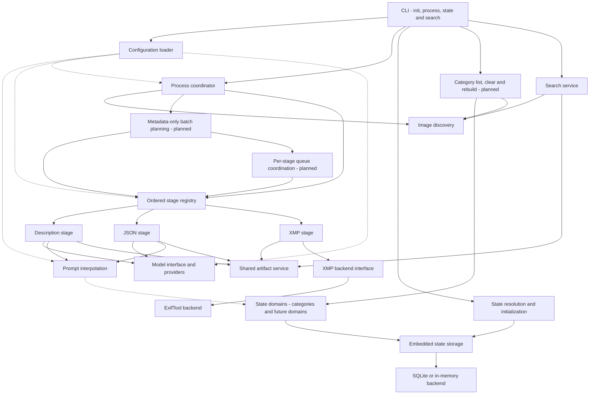
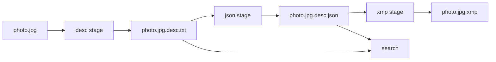

# HLD - Image Clarus

**Status:** Slices 1–3 implementation and closeout are complete. Slice 3 remedied the accepted Slice 2 prompt-control gap; historical evidence remains in the [Slice 2 plan](slice-2/IMPL-PLAN-slice-2.md). Slice 4 is planned, not implemented; its [REQ](slice-4/REQ-slice-4.md) remains draft.

**Date:** 2026-11-14

**Project:** `image-clarus`

**Requirements:** `docs/REQ-image-clarus.md`

**Delivery process:** Requirements → High-Level Design → Implementation Plan → Implementation

## 1. Purpose and scope

Image Clarus is an open-source Python CLI for turning image collections into searchable, reusable content. It generates a natural-language description, derives structured metadata, optionally writes digiKam-compatible XMP sidecars, and searches persisted descriptions and metadata. The original image is never modified.

This design establishes component boundaries, configuration semantics, artifact contracts, XMP ownership rules, safe-write behavior, and the first implementation slice. The requirements document remains the source for end-state capabilities. Detailed schemas, API parameter mappings, CLI flag inventories, and implementation tasks belong to the appropriate implementation plan unless explicitly decided here.

**Design principles**

- Independently executable, file-in/file-out processing stages. Independence does not imply a separate OS process per stage.
- Persisted sidecars are authoritative interstage handoffs, including when stages run sequentially in one CLI process.
- One configurable CLI, with minimal orchestration and no internal scheduler, mandatory persistent job queue, or mandatory centralized image database. Optional embedded application state is distinct from an image database or job queue.
- Reuse cross-cutting services without encoding stage-specific behavior in the coordinator.
- Source-image integrity, preservation of unrelated metadata, and recoverable sidecar writes.
- Linux is required; other OS support is desirable without a mandatory cross-platform CI matrix.
- Public project examples and test fixtures must contain no identifying photo or device metadata.

## 2. System architecture

### 2.1 Component view

**CLI and command routing.** Route `init`, `process` and `search`, global options, application version display, and help. Support `image-clarus --version`, `image-clarus --help`, and subcommand help, including `image-clarus search --help`. Slice 3 implements `init` and the state capabilities below; search remains a stub. Category list, clear and rebuild commands are planned for Slice 4.

**Configuration loader.** Discover, parse, merge defaults and CLI overrides, and validate general configuration; provide an immutable resolved configuration to consumers. The coordinator passes the entire resolved configuration to each stage without extracting stage-specific subsets.

**Application state and prompt interpolation.** Independent state resolution, storage, and domain operations expose reusable state across stages and invocation mechanisms. A separate interpolation facility supplies author-selected non-sensitive configuration and state values to replaceable prompts; it does not require a category-specific injection. Their contracts are described in §§4.4–4.5.

**Image discovery.** Discover eligible source image paths from files, directories, and patterns. It does not decide stage eligibility or processing success. Slice 4 adds reproducible traversal and a metadata-only plan, whose completion precedes batch execution; an aggregate dry-run need not retain every per-file record.

**Process coordinator.** Invoke selected stages in registry order per image, collect structured results, and apply configured continuation policy. Slice 4 plans in-memory per-stage queue coordination for concurrent batches and an image-first sequential mode. The coordinator does not infer prerequisites, parse stage output, choose provider parameters, or implement artifact-specific overwrite decisions.

**Ordered stage registry.** Built-in ordered definitions with stable public identifiers `desc`, `json`, `xmp`. Registry order determines execution order, regardless of the order in `--stages`; selection does not cause omitted prerequisite stages to run. Slice 4 adds reusable `usesLLM` and `skipIfValidOutputExists` capability metadata for planning, not stage-name branching. No dynamic plugin framework or dependency-graph engine is needed initially.

**Stages.** Each stage owns its input validation, prerequisites, completion/skip decision, create/overwrite/update policy, transformation, and result reporting. Stages use common configuration, provider, and artifact interfaces rather than duplicating infrastructure.

**Model interface and provider adapters.** Translate generic model requests into OpenAI-compatible HTTP calls, including authentication, image payloads, structured-output options, reasoning controls, and provider-specific errors. A provider adapter does not depend on the calling stage.

**Artifact service.** Read sidecars and perform shared safe writes, backup recovery, temporary-file cleanup, and appropriate permission handling. It is format-neutral; the XMP stage owns XMP merging and validation.

**XMP backend interface.** The XMP stage requests metadata read/transform/write operations through a replaceable backend; ExifTool is the sole initial implementation and is required only for XMP operations.

**Search service.** Search sidecars independently of the model pipeline, reusing file discovery and artifact access but not invoking stages or model providers.

### 2.2 Runtime and packaging boundary

Use Python 3.12 or newer, with Python 3.13 as the development baseline. Define dependencies and CLI packaging in `pyproject.toml`; manage development environments with `uv` and commit `uv.lock`. Application releases follow Semantic Versioning; Slice 1 starts at `0.1.0` and remains on the `0.1.x` line. The CLI reports the single authoritative package version through `image-clarus --version`. The generated metadata schema is versioned independently from the application. Description and JSON processing require no external executables. ExifTool remains an optional external prerequisite for XMP only. The project is intended for public open-source distribution under Apache-2.0; confirm repository licensing artifacts before publication.

### 2.3 Processing boundary

A stage receives the image path, resolved application configuration, and shared service interfaces, and returns a result such as `completed`, `skipped`, or `failed` with structured reason/category information. A selected stage remains runnable as a standalone CLI invocation or as part of a multi-stage invocation. These are architectural interface semantics, not prescribed Python class names.

## 3. Processing pipeline and artifacts

### 3.1 Persisted contracts

For a source image `photo.jpg`:

| Stage | Required input | Owned output | Initial completion policy |
| --- | --- | --- | --- |
| `desc` | `photo.jpg` | `photo.jpg.desc.txt` | Create if missing; skip if present unless regeneration requested |
| `json` | Valid `photo.jpg.desc.txt` | `photo.jpg.desc.json` | Create if missing; skip if present unless regeneration requested |
| `xmp` | Structured metadata selected for mapping and optional existing `photo.jpg.xmp` | `photo.jpg.xmp` | Apply field-specific merge and update policies |

Outputs use the complete source-image filename before the sidecar suffix. Stages read their persisted inputs rather than assuming in-memory outputs from previous stages. The source image remains unchanged.

The XMP stage may also read existing XMP content for merging. For Slice 2, JSON generation performs semantic inference, ranking and category placement; XMP consumes persisted JSON and deterministically applies configured publication policies without calling a model. JSON category paths do not include the XMP ownership root; the XMP stage applies a non-empty root or no prefix for an explicitly empty root. Search can run at any time after relevant sidecars exist.

### 3.2 Orchestration and stage autonomy

- With no stage selection, `process` selects all registered stages. `--stages=desc,json` selects only those stages; `--stages=json` does not automatically run `desc`.
- Slice 4 plans inter-stage concurrency **enabled by default** for multiple images: at most one active worker per selected stage, with different images able to occupy different stages. Disabling concurrency uses **image-first** sequential execution. Current single-image behavior remains unchanged until the planned implementation.
- Every selected stage independently evaluates its inputs and outputs. For example, an existing description may be skipped while missing JSON is created and XMP is updated.
- A failed earlier stage does not intrinsically make every later stage ineligible. An existing valid JSON file may still allow XMP work, subject to the configured continuation policy.
- Stage logic owns the distinction between create-only, regenerate, and merge/update. The coordinator must not treat the existence of any sidecar as a universal completed flag.
- In the Slice 4 plan, `desc` and `json` have both `usesLLM` and `skipIfValidOutputExists`; `xmp` has neither and evaluates `no_change` during execution. Regeneration and stage configuration affect bypass decisions. Metadata-only existence predicts a possible bypass, not valid output.
- Work-budget admission is per distinct image in deterministic discovery order, not independently per stage: an admitted image can execute multiple selected LLM stages for one slot. Budget-excluded images bypass LLM stages but remain eligible for selected non-LLM stages under their ordinary prerequisites and continuation policies; routing is based on capabilities, not a hardcoded XMP exception.
- A predicted bypass is forwarded to the next selected stage without waiting for unrelated upstream inference. Execution-time rechecks and existing stage validation, recovery and continuation remain authoritative; skipped valid JSON still contributes eligible categories without an extra model call. Report actual outcomes separately from predictions. In sequential mode, eligible category accumulation for an image should precede the next image; concurrent guidance may reflect timing.

### 3.3 Missing inputs and failures

A missing required prerequisite defaults to **failure for an explicitly selected single image** and **skip of the affected file/stage for a directory or pattern selection**. Configuration and CLI overrides can change this behavior, including for automated single-file runs.

Failure continuation is configurable: continue to the next selected stage, stop processing the current image and move on, or abort the run. **Stopping the current image is the default for ordinary stage failures**, but it is policy rather than hardcoded control flow. Ordinary `skipped` outcomes are not failures. Config and authentication errors are normally terminal. Incomplete or schema-invalid outputs are never marked completed.

## 4. Model integration and configuration

### 4.1 Configuration structure

One runtime YAML file, **`config.yaml`**, contains providers, named models, stage selections and policies, file discovery settings, XMP behavior, retries, and logging. Prompt text and JSON schemas are separate, independently replaceable files, with built-in defaults. Provider configuration may be separated into additional files in the future, but not initially.

Configuration resolution is an independent component:

1. Load built-in defaults.
2. Select **at most one** YAML file: an explicit `--config` file, or the first found in OS-specific user-level then system-level locations.
3. Apply dedicated CLI options and generic `--set path=value` overrides.
4. Validate global structure and override paths, then supply the resolved configuration to consumers.
5. Validate selected stage requirements only when that stage is selected, so an unused missing provider or stage-specific credential does not block an unrelated operation.

No implicit merge between user and system files. An explicit config file disables configuration-file discovery. Optional prompt and schema overrides have their own independent paths and fallbacks. State-directory selection is a separate resolution process (§4.5), with CLI and YAML choices ahead of directory discovery; it does not change configuration-file precedence. The final YAML key schema, generic override value parsing, and exact argument grammar, placement, repeatability, and conflict rules remain implementation-plan details; the accepted CLI conventions are listed in §5.

| OS | User configuration directory | System configuration directory |
| --- | --- | --- |
| Linux | `~/.config/image-clarus/` | `/etc/image-clarus/` |
| macOS | `~/Library/Application Support/image-clarus/` | `/Library/Application Support/image-clarus/` |
| Windows | `%APPDATA%\image-clarus\` | `%PROGRAMDATA%\image-clarus\` |

Installation must not require administrator permissions or create system-level configuration directories.

### 4.2 Named models and providers

Provider definitions own endpoint and authentication/connection configuration. Named model definitions reference providers, identify API model IDs, and specify default capabilities and generation parameters. Each model-driven stage **must select one named model**; several stages may share it or select different models/providers. CLI overrides can change a stage's named-model selection, and generic configuration overrides can change parameters of a named model. Stage-specific settings override shared model defaults where supported.

Slice 1 initially supports **OpenAI-compatible Chat Completions HTTP APIs** for local or remote endpoints; the architecture permits additional adapter types later. Credentials may be inline or obtained via a specifically named environment variable. Credential values sent in the Authorization header must be printable ASCII (`0x20`–`0x7E`); reject invalid values with a key-specific configuration error before provider execution. Do not log secrets. API compatibility does not imply that every endpoint supports identical image, schema, or reasoning controls. Unsupported capabilities must be surfaced clearly, not assumed to work.

Use one shared base-URL validation policy for preflight and the provider boundary: accept standard absolute HTTP and HTTPS URLs with DNS/FQDN names and all IPv4/IPv6 destinations. Reject malformed or non-absolute URLs, unsupported schemes, user-info, query strings, fragments, and an already-appended `/chat/completions` path. Reject malformed percent escapes and invalid raw ASCII characters in the authority or path. Before checking for the already-appended endpoint, normalize dot segments and percent-encoded unreserved path characters; leave encoded reserved characters distinct. Do not resolve hostnames or restrict destinations at application level; DNS and connection failures occur at request time. HTTP exposes credentials and request data without transport encryption; HTTPS is preferable. Configuration errors identify the affected key and an actionable sanitized reason without sensitive values, full endpoint URLs, or raw exception text.

### 4.3 Reasoning convention

Generic effort choices, ordered from least to most, are:

`minimal`, `low`, `medium`, `high`, `extra_high`, `max`, `ultra`.

`default` means preserve the configured model/provider default, normally by omitting a reasoning parameter; `off` explicitly requests disabled reasoning where possible. Built-in provider mappings translate generic values into native settings. Multiple generic levels may intentionally collapse onto one supported native level. Provider/model configuration can override mappings, including parameter name, disable mechanism, and supported native values. If a selected level cannot be mapped, report a clear error rather than silently falling back. Provider-native extensions remain possible. A `fast` or similar execution toggle is separate from reasoning effort. The Slice 1 Chat Completions mapping, configuration shape, and unsupported-capability behavior are frozen in the [A4 completion record](slice-1/IMPL-A4-COMPLETED.md).

### 4.4 Prompts and structured output

The built-in description prompt at `prompts/image-description.txt` is **exactly**:

> Fully describe and explain everything about this image.

Do not add text to that built-in prompt. Both description and JSON-generation prompts can be independently overridden with external files/CLI configuration and use the same macro facility. All model-facing prompt instructions, including contextual framing, must be user-editable: consolidate default instructions into the existing two prompt texts rather than adding prompt inputs or embedding unchangeable instructions in code. Built-in prompts remain fully replaceable, and users may remove, change or rearrange macros and surrounding wording. No hardcoded category-guidance injection or other mandatory contextual wording is required. A reusable interpolation facility exposes `config` (non-sensitive resolved configuration) and `state` (application state), including illustrative `{{config.stages.json.preferred_categories}}` and `{{state.categories.known}}`. The facility must accommodate future values rather than only these examples. Credentials and other secret-bearing values must not be interpolatable, directly or through containing configuration objects, including credentials resolved from environment variables. Macro grammar, expansion and serialization belong to subsequent design.

`preferred_categories` supports complete hierarchical paths and existing single-segment values. Preferred and accumulated known category paths are advisory, not a closed taxonomy; users decide whether accumulated state influences generation. No separate model call or automatic taxonomy reconciliation is required. Prompt wording is configurable data: unit tests requiring fixed text use independent fixtures so production prompt wording changes do not break previously passing tests.

The JSON stage consumes the persisted description and produces schema-validated structured metadata. Its built-in schema covers useful subjects/objects, actions, setting/context, visual features, search terms/tags, and model/prompt provenance. It must be fully replaceable by a user-provided schema, with configurable validation retry using error feedback. Slice 1's initial schema, prompt and provenance contract are recorded in its A3 completion record (§10.3). Slice 2 added distinct title, concise caption and ranked category recommendations; its design and implementation records preserve the historical contract and compatibility evidence.

### 4.5 Application state and resolution

The application-state facility is independent of processing stages and invocation mechanisms: single-image CLI, separately launched processes, digiKam scripting and eventual native batching use the same state and interpolation capabilities. It is not a mandatory image database, centralized server or persistent job queue. Separate responsibilities for state resolution, storage and domain operations allow independently evolving domains. Known hierarchical category paths are the first consumer; native batch execution history is a possible future consumer, not an implementation commitment.

Use embedded SQLite through Python's built-in `sqlite3` as the initial persistent backend, with storage internal to the application-owned `.image-clarus/` directory. Provide an in-memory backend when no state directory is explicitly selected and discovery finds no initialized repository. Persistent state survives separate invocations and supports independent processes accessing shared state safely, including schema versioning and migrations. Keep transactions short and never hold one during model inference. SQLite state concurrency is separate from the lock-free sidecar-write contract in §7.

`image-clarus init` explicitly initializes persistent state in `.image-clarus/` under the current working directory. Normal processing never initializes a persistent repository automatically. Resolve state in this order:

1. Explicit CLI state-directory parameter.
2. YAML-configured state directory.
3. Search the current working directory and its ancestors for `.image-clarus/`.
4. If none is found there, search the image directory and its ancestors.
5. If none is found, use in-memory state.

Current-working-directory discovery wins over image-directory discovery even when an image belongs to another initialized collection; nested initialized directories must be supported. Explicit selection allows one repository to be shared across unrelated collections. During ordinary image processing, state failures—including a missing, invalid, corrupted or inaccessible CLI- or YAML-selected directory—must produce visible error output without by themselves preventing otherwise valid stages or sidecar publication. Do not silently select another persistent repository; nonpersistent state may be used for the invocation. State-management commands such as `init` may fail independently. Keep discovery locations and ordering separable from persistence so a future release can make them configurable without redesigning storage; configurable precedence is not introduced here. Nested selection details, state-failure reporting, SQLite schema, migration SQL, macro grammar and implementation algorithms belong to subsequent design.

Slice 4 plans category list, clear and rebuild operations with their own implementation-plan phase. Listing reads the selected state; clear removes its category domain only. Rebuild replaces that domain from a selected collection's existing JSON using the same envelope, schema-identity and category extraction rules as ordinary accumulation, not XMP or inference. Its traversal depth is independently configured, recursive and unlimited by default, with the same symlink policy as batch discovery. Report invalid/unreadable input and never report a partial replacement as successful; mutations preserve other domains and must not silently substitute another persistent store. Warn that a limited rebuild replaces the shared repository's categories with the selected collection's categories. State-command failures may fail those commands; ordinary processing keeps its nonblocking policy.

## 5. CLI and operational architecture

The end-state CLI has these subcommands:

- `image-clarus process` — process selected image files using selected stages.
- `image-clarus search` — search previously generated sidecars without model calls.
- `image-clarus init` — explicitly initialize persistent application state in the current working directory.
- Category-state `list`, `clear`, and `rebuild` operations — planned for Slice 4; exact command grammar is design work.

**Accepted CLI conventions:** The executable is `image-clarus`, with `process`, `search`, and `init` subcommands, and help at the top level and each subcommand. Stable stage identifiers are `desc`, `json`, and `xmp`. The accepted option names are `--config` for an explicit config path, `--stages` for stage selection, and `--set` for generic configuration overrides. The stage-selection behavior in §3.2 is fixed: no selection means all registered stages, while an explicit selection runs only those stages without prerequisite expansion.

**Illustrative syntax:** Examples such as `--stages=desc,json` and `--set path=value` show intended option/value shapes, not a frozen argument grammar. The implementation plan for the relevant slice will settle exact argument placement (`=` versus a separate value), repeatability, positional arguments, `--set` value parsing, option conflicts, and output/result schemas.

**Slice 4 controls (planned):** `--max-depth`, `--max-work-files`, `--dry-run`, and `--verbose`, plus a configuration/CLI concurrency control and independently configurable rebuild depth. Exact remaining option/configuration names and output grammar are design work; these controls are not a claim of current implementation.

**Discovery.** Accept file paths, directories, and glob patterns/filters. Slice 4 plans unlimited recursion by default, `--max-depth 0` for the starting directory, and N for N levels below it. Discover eligible files in each directory before descending into subdirectories, using deterministic ordering; execution order may differ under concurrent processing. Do not follow discovered symlinks; an explicitly supplied image or directory symlink may resolve as specified in the Slice 4 REQ. A configurable extension allowlist initially considers `jpg`, `jpeg`, `png`, `webp`, `tif`, and `tiff`. Model decoding failures are distinct from extension selection. Advanced exclusion filters remain later work.

**Planning, execution and resumption.** Slice 4 plans a completed metadata-only initial plan before batch execution: directory entries and sidecar existence only, without image/sidecar-content reads, ExifTool or model calls, or mutations. A positive `--max-work-files` admits the first N distinct images initially needing any selected LLM stage; each admitted image counts once even when multiple selected LLM stages execute. Non-LLM work consumes no budget and runtime changes do not replenish it. Initial queues reflect provisional existing-output bypasses and LLM-budget exclusions: excluded images bypass LLM stages, not selected non-LLM stages. Admitted images advance as stages complete or skip; non-LLM stages receive eligible images progressively, including direct initial routes, subject to normal prerequisites and continuation. Stage-level runtime rechecks and results remain authoritative. `--dry-run` reports admission, routing and counts without execution and must report a clearly labeled memory estimate, not a measurement or guaranteed bound; the estimation scope and method are design work. Aggregate output need not retain all file records. Existing valid sidecars support later rescan/resume without a persistent job queue. External schedulers own timing; digiKam scripting complements, but does not replace, native batching. Native search remains independent.

**Failures and reporting.** Model/provider, timeout, authentication, invalid configuration, schema validation, corrupt/unsupported image, missing prerequisite, and filesystem errors have distinguishable categories. Built-in retry count is **zero**; opt-in retry/backoff and category-specific actions are configurable. Slice 4 plans `--verbose` stage/image progress, reasons and elapsed times for single-image and batch runs, plus batch metrics for eligible files, initially admitted LLM-work images, planned bypasses, actual stage outcomes and deviations. Distinguish file counts from stage-operation counts and planned bypasses from actual skips, failures or interrupted/not-attempted work. Progress completion does not imply success. Preserve concise non-verbose output and configurable logging/exit behavior.

**Interruption.** Safely cancel an in-flight model request when stopping; once an artifact write begins, finish its safe-write operation where possible before exit. Slice 4 workers stop accepting new work, coordinate shutdown and report partial actual outcomes. Recovery covers interrupted writes when graceful shutdown is impossible; resumption rescans sidecars.

## 6. XMP and digiKam integration

### 6.1 Scope and backend

The XMP stage uses a replaceable backend interface with **ExifTool as the sole initial backend**. ExifTool is an optional runtime dependency needed only when XMP is selected. The stage transforms and validates XMP metadata; the shared artifact service handles safe persistence of a temporary working sidecar. No source image is edited.

**This release updates digiKam-compatible tag representations only.** Other observed vendor-specific keyword/tag representations (including ACDSee, MediaPro, and MicrosoftPhoto) are preserved, not synchronized. A later release may offer independently configurable mappings for other applications, preserving the REQ's longer-term extensibility goal.

### 6.2 Previously observed XMP representations

Earlier inspection of a digiKam sidecar recorded these representations of one hierarchical tag:

| Field | Observed example | Interpretation / design caution |
| --- | --- | --- |
| `digiKam:TagsList` | `garden/container` | digiKam hierarchical tag representation |
| `lr:hierarchicalSubject` | `garden\|container` | Hierarchical representation using a different separator |
| `dc:subject` | `container` | Flat keyword representation; may mix generated and manual tags |
| `MicrosoftPhoto:LastKeywordXMP` | `garden/container` | Other-software representation; **not written this release** |

ACDSee and MediaPro representations were also present in the inspected file. The sample had no populated `dc:title` or `dc:description`. These are **observations**, not proof that every listed field must be modified for digiKam interoperability. In particular, avoid assuming `lr:hierarchicalSubject` is writable merely because it is present. Exact write targets, hierarchy conversion, and handling of shared flat keyword lists require fixture-based verification, without restarting the completed high-level discovery.

Slice 2 A3 selected a preliminary mapping: `digiKam:TagsList` for slash-separated assignments and the `x-default` alternatives of `dc:title`, `dc:description`, and `digiKam:CaptionsAuthorNames`; preserve shared flat keywords and other observed vendor representations. Synthetic ExifTool checks alone do not prove digiKam interoperability. The [C3 record](slice-2/IMPL-C3-COMPLETED.md) documents Product Owner-reported import, edit and reread, including the corrected incompatibility; see also the historical [A3 design record](slice-2/IMPL-A3-COMPLETED.md).

### 6.3 Tag hierarchy ownership and policies

The generated tag subtree has a **configurable top-level hierarchy root**, default **`ai`** when omitted. An explicitly configured empty string (`""`) adds no root prefix; it must not be confused with an omitted setting. This is a digiKam tag hierarchy, **not a new XML namespace**. Do not default to `auto`: digiKam's Auto Tag replacement behavior can remove tags under that branch. The table applies to non-empty roots.

| Tag policy | Meaning | Default |
| --- | --- | --- |
| `add` | Merge generated tags into the configured subtree without duplicates | **Yes** |
| `overwrite` | Replace only generated-root tags with the new generated set | No |
| `new` | Add tags only if the generated root has no existing tags for this image | No |
| `disabled` | Do not change generated-root tags | No |

**Empty-root exception, Product Owner decision:** With an explicitly empty root, `disabled` makes no tag changes; `add`, `overwrite`, and `new` each behave as `add`, without duplicates or deletion of any existing tags. For a non-empty root, the selected policy governs assignments inside that root, including manual assignments there, and must never add, delete, or modify tags outside it. Preserve unrelated flat keyword values, camera/exposure metadata, and XML namespaces. If the selected XMP backend cannot preserve these invariants for an observed representation, treat that as a mapping/validation issue rather than replacing the entire tag set.

### 6.4 Title and description policies

Title and description are independent XMP fields, each supporting `new`, `overwrite`, and `disabled`:

- **`new` is the hardcoded default for both.** Populate only if absent or empty.
- `overwrite` replaces the current field value.
- `disabled` leaves the field unchanged.

Not every structured JSON field is exported to XMP. Under the accepted Slice 2 requirements, absent or supported empty optional source values leave the corresponding destination unchanged, even under `overwrite`. An optional config-supplied caption author has separate `new`, `overwrite`, and `disabled` policies; absent configuration leaves author metadata unchanged. A3 and A4 define the preliminary mappings and localized-value handling; C3 records accepted, Product Owner-reported interoperability evidence.

Slice 2 A4 defines `new` as writing only when all language alternatives for the field are absent or empty, and `overwrite` as updating only `x-default`; other languages remain intact. The [A4 record](slice-2/IMPL-A4-COMPLETED.md) defines the historical design contract; subsequent implementation and verification are recorded in the [Slice 2 plan](slice-2/IMPL-PLAN-slice-2.md).

### 6.5 Validation and public fixtures

Confirm that generated hierarchical tags appear in digiKam and remain editable. Verify manual tags outside a non-empty generated root remain intact, and all existing tags remain intact during empty-root updates. Confirm title/description behavior through actual digiKam display and editing. Compare before/after XMP to detect unintended changes to unrelated fields.

Before committing any sample XMP or photographic fixture to the **public repository**, remove or anonymize GPS/location coordinates, camera and lens make/model, serial numbers, owner/device identifiers, and other private metadata. Non-private example tags such as `garden/container` may remain. This fixture sanitization is a repository-publishing rule; **normal user XMP processing must preserve** existing unrelated metadata, not scrub it.

## 7. Filesystem safety and concurrency

### 7.1 Shared safe-write workflow

For any stage-owned sidecar:

1. Resolve interrupted-operation recovery before the stage decides whether its output exists.
2. Prepare the complete new content in a **uniquely named temporary file** in the destination directory.
3. Flush, close, and validate temporary content before replacement.
4. If the destination exists, create or refresh its recoverable `.bak` backup from the **current original** and flush it; replace any older backup rather than preserving a stale version as the active backup.
5. Replace the destination using the safest available filesystem operation, verifying the result and retaining appropriate permissions where feasible.
6. Remove the backup after verified success unless retention is configured; clean up disposable temporary files when safe.

**Recovery defaults:** If the destination is missing but its `.bak` exists, validate the backup with the selected stage's validator before restoring it. If validation fails, preserve the backup and do not publish it as the destination. If both destination and backup exist, the destination is authoritative; never overwrite it automatically with `.bak`. When creating a new backup, overwrite the previous backup using the current destination. Leftover temporary files are **disposable** and never used as recovery sources; only clean up files established as stale to avoid deleting another active process's temporary work. Failed-write fallback recovery uses the same stage validator.

Attempt `0600` for new sidecars and preserve existing mode bits for replacement, backup and recovery; verify exact mode where the filesystem supports it. A demonstrated inability to represent or enforce POSIX modes must not by itself defeat a valid transaction, but permission denials, I/O errors and other unrelated failures remain errors. Do not use a filesystem-name allowlist as a capability test. Mode limitations may expose sidecars and backups; users must choose a suitably private filesystem or mount when confidentiality matters. The approved correction supersedes A5's original unconditional mode-equality rule. Automated tests cover supported and simulated unsupported modes; the operator reported successful artifact publication and a synthetic create-only probe on Linux-mounted NTFS/FUSE. The probe reported mode `0777` and emitted the privacy warning. This does not establish crash durability or native Windows execution; see the [Slice 1 C5 closeout](slice-1/IMPL-C5-COMPLETED.md).

The service must account for filesystems on which replacement or durability is not guaranteed atomic. Do not claim crash-proof behavior across ext4, XFS, NTFS/FUSE, VFAT, or virtual filesystems. Add filesystem-specific behavior only if a concrete compatibility issue is demonstrated.

### 7.2 Deliberately lock-free concurrent access

**No application-level sidecar file locking in the initial architecture.** Independent processes use unique temporary files, and filesystem-supported replacement rather than directly interleaving destination writes. Where replacement is atomic, readers see complete versions; **last replacement wins** when writers race. Embedded SQLite concurrency is a separate state-storage concern, not a change to this sidecar contract.

Possible rare consequence: one writer's description, JSON, or XMP merge may supersede another's result, losing concurrent edits (including edits from digiKam). The app does not promise to detect these conflicts or make concurrent XMP merges serializable. Filesystem errors are reported normally; Linux does not ordinarily refuse writes just because another process is updating the same path. Concurrent backup/cleanup races also cannot be completely eliminated without coordination; document this limitation, rather than promising stronger protection than implemented.

Users who may run Image Clarus concurrently with digiKam can coordinate runs externally. The sidecar service has no lock files, stale-lock recovery protocols, or lock timeouts; this does not prohibit SQLite's own concurrency mechanisms.

Slice 4's planned stage workers use the same per-operation safe-write and interruption/recovery contract. Worker coordination does not add cross-process sidecar locks, conflict detection, serialized XMP merges, or atomic coupling to state.

## 8. Implementation strategy and slice roadmap

Build independently usable, numbered slices. Each slice has its own implementation plan; the HLD establishes boundaries, while that plan defines its phases, steps, acceptance criteria, testing, and sequencing. `Phase A`, `Phase B`, `Phase C`, and step identifiers are plan-internal labels, not slice names.

| Slice | Architectural capability | Boundary |
| --- | --- | --- |
| **Slice 1** | **Single-image `desc` + `json` pipeline** | CLI `process` and help; YAML config; named models/providers; OpenAI-compatible adapter; stage registry/coordinator; independent stage selection; configurable prompts and schema; JSON validation/provenance; shared safe-write and recovery; basic failure reporting |
| **Slice 2 (complete and accepted)** | JSON enhancement and XMP integration | Single-image ranked recommendations, ExifTool backend, digiKam mappings, tag hierarchy/policies, title/caption/optional author and sanitized fixtures; accepted prompt-control gap carried forward |
| **Slice 3 (complete)** | User-owned prompts and application state | Namespaced macros, hierarchical category guidance, reusable SQLite/memory state, nonblocking accumulation and opt-in prompt hash; see [Slice 3 plan](slice-3/IMPL-PLAN-slice-3.md) and its closeout |
| **Slice 4 (planned; REQ draft)** | Native batch, diagnostics and category-state management | Metadata-only planning, traversal and work controls, optional inter-stage concurrency, progress and category list/clear/rebuild; see [Slice 4 REQ](slice-4/REQ-slice-4.md) |
| Later | Deterministic search | `search` command, sidecar text/field matching, human-readable and JSON results, shared discovery |
| Future | Extensibility | Other XMP backends, other metadata consumers/providers, richer filters, semantic search |

The ordering among later slices is indicative, not a locked schedule. Future search and batch capabilities may be split or reordered when their own slice plans are formed, without changing this HLD's component boundaries.

**Why Slice 1 contains two stages:** It provides useful structured metadata immediately and exercises two independent model selections, shared-provider reuse, persisted stage handoffs, independently invoked stages in separate OS processes, concurrency and last-write-wins behavior, schema validation, and early assessment of JSON quality before committing to XMP mappings. Single-image invocation is sufficient for these tests; Slice 1 does not require directory traversal or an internal concurrency scheduler.

## 9. Verification approach

- **Stage independence:** Run `desc`, `json`, and their combination; verify registry order, selected-stage-only behavior, missing prerequisites, skip/new-only logic, regeneration and configurable continuation.
- **Models:** Use distinct named models for `desc` and `json`, then a shared model; validate local/remote OpenAI-compatible transport, credentials, reasoning mapping, disabled/default reasoning, and unsupported capability errors.
- **Structured output:** Inspect real JSON results for usefulness and schema conformance; reject malformed output and test optional validation retry. Verify provenance without committing private tokens or endpoint secrets.
- **State and prompts:** Verify explicit initialization and resolution precedence, explicit-selection failures, in-memory fallback, shared-process concurrency and migrations, and that no transaction spans model inference. Exercise macro expansion with non-sensitive fixture values and secret exclusion, including containing objects and environment-resolved credentials; use independent prompt fixtures instead of freezing production wording.
- **Filesystem safety:** Exercise create, replace, backup restoration, existing-original-plus-backup, interrupted writes, stale temporary cleanup, permissions, and deliberate overlapping writes. Explicitly test last-write-wins limitations rather than presenting them as conflict detection.
- **XMP:** Use sanitized representative digiKam fixtures, ExifTool round trips, field-specific policies, shared flat-keyword preservation, and digiKam read/edit checks. No private EXIF/GPS/device data in public fixtures.
- **Batch and search:** Test streaming traversal order, independent failure/skip counts, deterministic case-insensitive matching, selected JSON fields, and machine-readable output when those slices are implemented.
- **Slice 4 planned verification:** Exercise metadata-only planning and dry-run boundaries, deterministic admission, actual concurrent stage overlap and sequential mode, runtime rechecks, category rebuild, progress accounting, failure and interruption/resume. Use synthetic inputs and keep execution results distinct from predictions.
- **Platforms:** Required Linux testing and representative available filesystems. macOS and Windows remain desirable portability targets; no exhaustive OS/filesystem CI matrix.

## 10. Decision register and open questions

### 10.1 Decided

- Single CLI `image-clarus` with `process`, `search` and explicit state `init`, including top-level and subcommand help plus `image-clarus --version`.
- Application releases use Semantic Versioning; Slice 1 starts at `0.1.0` and stays on the `0.1.x` line. The JSON metadata schema version is independent of the application version.
- Independent `desc`, `json`, `xmp` stages using persisted file handoffs; ordered registry and selectable subsets with no automatic prerequisite expansion. Slice 4's planned batch default is inter-stage concurrency, with image-first retained when disabled.
- Slice 4 plans metadata-only Option A, `usesLLM`/`skipIfValidOutputExists` capabilities and initial distinct-LLM-image work budgeting. Content-aware planning Option B is deferred; Option A remains available if B is later implemented. One worker per stage is the Slice 4 limit; multiple workers per stage and model-aware scheduling are outside its scope.
- Coordinator delegates configuration interpretation and completion policy to each stage and applies configurable continuation policy to structured results.
- One YAML `config.yaml`, prompts/schemas external and separately overridable; configuration precedence CLI > selected YAML > defaults; global then selected-stage validation.
- Named provider and model configuration, with model selection per model-driven stage; initial OpenAI-compatible Chat Completions transport; configurable generic-to-native reasoning mapping.
- Shared format-independent artifact service, `.bak` recovery defaults, disposable stale temp files, no sidecar file locking, accepted last-write-wins behavior.
- Embedded SQLite application state via `sqlite3`, explicit initialization and the resolution precedence in §4.5; separate resolution, persistence and domain operations. When no repository is selected or discovered, use in-memory state; state failures during processing are visibly reported and nonblocking, with optional nonpersistent state but no silent substitution of a different persistent repository.
- Extensible user-controlled prompt interpolation with non-sensitive `config` and application `state` namespaces; no secret-bearing configuration exposed and no mandatory hardcoded contextual framing.
- digiKam-only tag writes for the initial XMP release; omitted root defaults to `ai`, never `auto`; `add` is the default tag policy. Non-empty-root policies affect only that root; an explicitly empty root forces `add` for enabled policies and never deletes existing tags.
- Title and description independently default to `new`, with `overwrite` and `disabled` alternatives.
- ExifTool only for initial XMP backend; independent native search without model calls or a mandatory image database.
- **Slice 1 contains both description and structured JSON generation for one image.**

### 10.2 Observed, not yet fully mapped

- Earlier digiKam XMP showed `digiKam:TagsList`, `lr:hierarchicalSubject`, and `dc:subject` alongside representations from MicrosoftPhoto, ACDSee, and MediaPro.
- The inspected sample had no populated XMP title or description.
- These observations alone do not establish writable field subsets or interoperability; Slice 2's subsequent synthetic and Product Owner-reported evidence is recorded in C2 and C3.

### 10.3 Open for implementation planning

- **Phase A design handoff (historical readiness gate):** The Slice 1 plan records A1 package/runtime/dependency/version-source choices; A2 CLI, configuration, typed `--set`, result, failure, and exit contracts; A3 JSON schema/prompt/provenance and artifact-validity rules; A4 Chat Completions request, reasoning mapping, transport, and security rules; and A5 safe-write transaction, backup-retention (`pipeline.backup_retention`), recovery, and concurrency rules. A4 limits Slice 1 generation controls to reasoning effort, deferring HLD §4.2's broader generation-parameter capability without removing that end-state requirement; its provider-path redaction preserves A2's intentional result-path reporting. See [IMPL-PLAN-slice-1.md](slice-1/IMPL-PLAN-slice-1.md) and its linked completion records. Erik accepted the A3 Product Owner review during A6; the Phase A readiness gate has passed. At that handoff Phase B/C implementation had not started; later work is recorded in the plan.
- Initial schema versioning, bounded validation retries, selected-stage missing-input behavior, continuation, logging/result output, and single-image exit behavior are recorded in A2/A3 and exercised in Slice 1; see the [C5 evidence crosswalk](slice-1/IMPL-C5-COMPLETED.md). Subsequent Slice 2 behavior is recorded in its own plan; other later-slice capabilities remain unimplemented unless separately recorded.
- A5 freezes artifact-service transaction/state/fault semantics and the backup-retention config leaf in [IMPL-A5-COMPLETED.md](slice-1/IMPL-A5-COMPLETED.md). B5 implemented the original service; the approved mode correction has automated evidence and an operator-reported NTFS/FUSE probe. The Product Owner accepted the documented test-order evidence exception. See the [correction record](slice-1/IMPL-SAFE-WRITE-FILESYSTEM-CORRECTION.md) and [C5 closeout](slice-1/IMPL-C5-COMPLETED.md). Do not add filesystem-specific branches or claim crash-proof writes without observed evidence.
- Slice 2 A3 records the preliminary JSON-to-XMP mapping and preservation contract; accepted C3 records Product Owner-reported digiKam interoperability and its limits.
- Slice 3 A1/A2 settled the state and prompt facilities, including storage and migration mechanics, discovery, macro grammar and secret-safe interpolation; implementation and evidence are recorded in the [Slice 3 plan](slice-3/IMPL-PLAN-slice-3.md). Its final closeout status is tracked there.
- Slice 4 planning must resolve how provisional bypasses are rechecked and routed if invalid or missing, including ordering with downstream execution; early overlap must coexist with explicit image-first sequential mode. The Product Owner decided that LLM-budget-excluded images remain eligible for selected non-LLM stages under ordinary prerequisite and continuation policies; XMP-only execution remains uncapped. This mixed-stage decision is distinct from deferred content-aware planning Option B. Resolve state selection across collections and category-command discovery context; rebuild handling of invalid/unreadable or empty inputs; failure/abort and exit aggregation; and progress accounting for excluded, failed and interrupted work. Resolve pattern overlap, deterministic admission across roots and invalid control values without silently adding product policy. Escalate any choice that changes approved scope or behavior.

### 10.4 Deferred without narrowing the end-state requirements

- Non-digiKam metadata representations and additional XMP backends.
- Native search, advanced exclusion filters, multiple workers per stage, scheduling, content-aware planning Option B and semantic search remain outside Slice 4; later scope and ordering are not assigned here.
- Additional provider protocols, optional separate provider configuration files, and broad cross-platform automation.

### 10.5 Requirements reconciliation

The Product Owner has superseded the earlier B2 HTTP destination restriction: the shared HTTP/HTTPS policy above and the REQ govern; the B2 record preserves the earlier decision as history. Implementation and verification of this change must be established by separate evidence.

The Product Owner explicitly decided the empty-root policy in Slice 2: omission selects `ai`; an explicit empty string makes enabled tag policies additive and non-destructive. The parent REQ and §6.3 now reflect that decision. The Product Owner accepted the Slice 2 REQ on 2026-11-17; XMP mappings, schema details and implementation are not established by that acceptance.

The November 2026 parent REQ refinements specify general-purpose state, explicit initialization and discovery, independent full prompt control and secret-safe macros. Sections 4.4–4.5 record the selected embedded SQLite architecture and these decisions. The Slice 2 prompt-control gap was accepted at closeout and subsequently remedied in Slice 3; the separate early-identification process lesson remains recorded in the REQ. Slice 2 implementation and verification were completed as recorded in its plan and closeout, not merely by acceptance of its REQ.

The Product Owner subsequently clarified that state failures, including invalid explicit selections, produce visible error output but do not by themselves block core processing; nonpersistent state may be used without silently selecting another persistent repository. The former no-memory-fallback rule is superseded for ordinary processing. The existing prompt inputs remain user-owned and contain the default instructions; no additional prompt inputs or hidden unchangeable instructions are introduced.

The REQ now reflects the approved decisions that Slice 1 includes single-image `desc` and `json` processing, with both stages independently invocable; application releases use SemVer with Slice 1 starting at `0.1.0`; the CLI exposes `--version`; the JSON schema version is independent; XMP title and description default to `new`; and initial sidecar writes are lock-free with last-successful-replacement-wins behavior and accepted lost-update risk. These decisions are recorded in Slice 1's implementation plan and carry into later plans where relevant. Other metadata representations remain part of the end-state requirements but are not synchronized in the initial XMP release.
